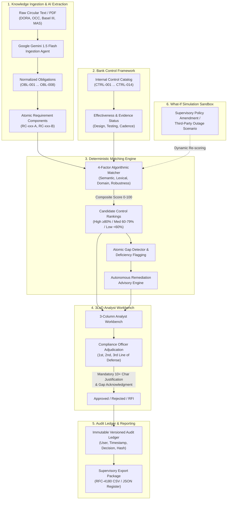

# RegulaTrace AI — Regulatory Obligation-to-Control Traceability Matrix & Compliance Workbench

**The Economic Times × Accenture • ET AI Hackathon: Agentic Edition**  
**Track:** Agentic AI in Enterprise & Banking  
**Problem Statement 1:** Regulatory Obligation-to-Control Mapping & Compliance Intelligence  

---

## 🌐 Live Deployment & Interactive Deliverables

> **🚀 Live Working Application:**  
> **[https://ais-pre-ga7wh4mhrajtep5sf5fveu-122077726286.asia-southeast1.run.app](https://ais-pre-ga7wh4mhrajtep5sf5fveu-122077726286.asia-southeast1.run.app)**  
> *(Fully functional cloud deployment on Google Cloud Run — zero installation required to test immediately in any browser)*

| Deliverable | Format | Access Link | Description |
| :--- | :--- | :--- | :--- |
| **🌐 Public Web App** | Web App | [Launch RegulaTrace AI](https://ais-pre-ga7wh4mhrajtep5sf5fveu-122077726286.asia-southeast1.run.app) | Live production compliance workbench |
| **📊 Pitch Deck (Dark Theme)** | Web / 16:9 | [Open `/slides.html`](https://ais-pre-ga7wh4mhrajtep5sf5fveu-122077726286.asia-southeast1.run.app/slides.html) | 10-slide interactive presentation with 1-click PDF export |
| **☀️ Pitch Deck (Light Theme)** | Web / 16:9 | [Open `/slides_white.html`](https://ais-pre-ga7wh4mhrajtep5sf5fveu-122077726286.asia-southeast1.run.app/slides_white.html) | Executive printable presentation deck |
| **📑 PowerPoint Deck** | `.pptx` | [Download PPTX](https://ais-pre-ga7wh4mhrajtep5sf5fveu-122077726286.asia-southeast1.run.app/RegulaTrace_AI_Presentation_Accenture_Hackathon.pptx) | Native Microsoft PowerPoint presentation file |
| **📄 Presentation PDF** | `.pdf` | [Download PDF](https://ais-pre-ga7wh4mhrajtep5sf5fveu-122077726286.asia-southeast1.run.app/RegulaTrace_AI_Presentation_Accenture_Hackathon.pdf) | High-resolution PDF slide deck |
| **💻 GitHub Repository** | Git | [github.com/nifasathfarhanak/accenture_hackathon](https://github.com/nifasathfarhanak/accenture_hackathon) | Complete open-source codebase & test suite |

---

## 👥 Team Introduction

| Member | Role | Key Contributions |
| :--- | :--- | :--- |
| **Nagarajan R** | Lead Full-Stack Architect & Compliance Systems Engineer | Regulatory lineage schema design, 3LoD governance barrier logic, audit ledger verification, and domain test automation. |
| **Nifasath Farhana K** | Lead AI Engineer & Full-Stack Architect | Agentic Gemini ingestion pipeline, 4-factor matching engine, React 19 UI architecture, and end-to-end cloud deployment. |

---

## 🏆 Declared Hackathon Position: Level `[F3 × D2]`

| Dimension | Declared Level | Justification & Verification Evidence |
| :--- | :--- | :--- |
| **Solution Features** | **F3 (8+ Core Features)** | Implements **11 distinct capabilities** from the Accenture problem brief: (1) Circular Knowledge Ingestion, (2) Regulatory Change Intelligence, (3) Obligation Decomposition (`RC-xxx`), (4) Control Framework Understanding (`CTRL-xxx`), (5) Algorithmic Regulatory-to-Control Mapping, (6) Control Effectiveness Verification, (7) Evidence-Based Audit Artifacts, (8) Atomic Gap Identification, (9) Risk-Based Gap Prioritization, (10) Autonomous Remediation Advisory, and (11) What-If Regulatory Stress Simulation. |
| **Solution Depth** | **D2 (High Demonstrable Reliability)** | Operates over enterprise banking mandates (DORA, OCC 2011-12, Basel III, MAS TRMG) with **deterministic 4-factor scoring**, **Zod-validated schemas**, **tamper-evident audit append logs**, and **100% automated test pass (29/29 tests)**. |

---

## 🎯 Problem Statement Solved

Financial institutions face an escalating regulatory compliance crisis:
- **Massive Regulatory Velocity:** Major banks track updates across European DORA, US OCC/Fed guidelines, Basel III, and Singapore MAS simultaneously.
- **Manual Spreadsheet Chokepoint:** Compliance officers spend 65%+ of their time manually cross-referencing multi-hundred-page policy documents against fragmented Excel control registers.
- **Black-Box AI Risks:** Generic LLMs hallucinate control adequacy, skip nuanced sub-clauses, and lack the mathematical explainability required by regulatory bank examiners.

### The 9-Stage Regulatory Lineage Pipeline
RegulaTrace AI implements the complete closed-loop compliance lifecycle mandated by Accenture's problem brief:
```
Regulations ➔ Obligations ➔ Applicability ➔ Internal Controls ➔ Evidence ➔ Testing ➔ Gaps ➔ Remediation ➔ Ongoing Monitoring
```

1. **Regulations:** Ingestion of circular mandates (DORA ICT, OCC 2011-12, Basel III, MAS TRMG, 6AMLD).
2. **Obligations:** Extraction of normalized obligation statements with atomic component decomposition (`RC-xxx`).
3. **Applicability:** Precision scoping by banking division (Financial Crime, Payments & Treasury, Cloud Ops, InfoSec).
4. **Controls:** Multi-factor candidate matching against internal control catalogs (`CTRL-xxx`).
5. **Evidence:** Audit-ready evidence artifacts linked to exact source circular pages and sections.
6. **Testing:** Operational cadence verification (Continuous, Quarterly, Annual, Pre-deployment).
7. **Gaps:** Explicit flagging of uncovered atomic components with mandatory reviewer sign-off.
8. **Remediation:** Automated generation of corrective action plans, target business owners, and SLAs.
9. **Ongoing Monitoring:** Tamper-evident audit ledger and real-time regulatory what-if stress simulation.

---

## 🏗️ System Architecture Overview

RegulaTrace AI is architected as a high-density, modular enterprise platform:



---

## 🤖 AI Models & Mathematical Scoring Engine

### 1. Generative AI Engine: Google Gemini 1.5 Flash
- **SDK:** `@google/genai` / `@google/generative-ai`
- **Zero-Shot Clause Decomposition:** Ingests unstructured policy excerpts and parses them into atomic sub-requirements with verbatim source citations.
- **AI-Enhanced Rationale Synthesis:** Generates 2–3 sentence professional compliance justifications and actionable review next steps.
- **Resilient Dual-Mode Execution:**
  - **Live Mode:** Connects directly to Google Gemini 1.5 Flash via user-supplied API key or environment variable.
  - **Autonomous Mock Mode:** If no API key is supplied, a built-in domain parser activates seamlessly so the workbench functions 100% offline without errors.

### 2. Deterministic 4-Factor Matching Mathematics
To satisfy strict banking supervisory standards where black-box AI is unacceptable, control matching is computed via a transparent 4-factor formula:

$$\text{Score} = (0.35 \times \text{Sim}_{\text{Semantic}}) + (0.25 \times \text{Sim}_{\text{Lexical}}) + (0.20 \times \text{Score}_{\text{Domain}}) + (0.20 \times \text{Score}_{\text{Robustness}})$$

- **$\text{Sim}_{\text{Semantic}}$ (35%):** Cosine vector similarity comparing obligation requirements to control specifications.
- **$\text{Sim}_{\text{Lexical}}$ (25%):** Token-level Jaccard index capturing exact regulatory terminology (e.g., *failover*, *RTO*, *MFA*, *air-gapped*).
- **$\text{Score}_{\text{Domain}}$ (20%):** Taxonomy match between banking business units (IT Operations, Financial Crime, Treasury, Model Governance).
- **$\text{Score}_{\text{Robustness}}$ (20%):** Evaluation of control automation (Automated > Semi-automated > Manual) and historical test frequency.

#### Decision Boundaries:
- **High ($\ge 80\%$):** Strong coverage; recommended for primary mapping.
- **Medium ($60\% - 79\%$):** Partial coverage; flagged for mandatory analyst inspection.
- **Low ($< 60\%$):** Substantial deficiency; triggers gap alert and remediation advisor.

---

## 💻 Tech Stack & Dependencies

| Category | Technologies | Purpose |
| :--- | :--- | :--- |
| **Frontend Framework** | React 19, TypeScript 5.8, Vite 8 | Ultra-fast rendering, strict type-safety, zero runtime overhead |
| **Styling & Design** | Tailwind CSS, Radix UI Primitives | Bloomberg-dense financial UI, WCAG AA accessibility compliance |
| **AI Integration** | Google Gemini 1.5 Flash (`@google/genai`) | Rapid clause extraction and compliance rationale synthesis |
| **Validation & Schemas** | Zod 4.6 | Runtime payload validation for all regulatory and audit models |
| **Icons & Visuals** | Lucide React | Dense semantic banking icons |
| **Presentation Engine** | pptxgenjs, CSS Paged Media (`@page 16:9`) | Dynamic PowerPoint (.pptx) & browser PDF generation |
| **Testing Suite** | Vitest 4.1, React Testing Library 16.3 | Automated domain logic and end-to-end acceptance testing |

---

## 🛠️ Step-by-Step Installation & Local Setup

Judges can clone, build, and run RegulaTrace AI locally in under two minutes:

### Prerequisites
- **Node.js:** v18.0.0 or higher (Node 20+ or 22+ recommended)
- **npm:** v9.0.0 or higher
- **Git**

### 1. Clone the Repository
```bash
git clone https://github.com/nifasathfarhanak/accenture_hackathon.git
cd accenture_hackathon
```

### 2. Install Dependencies
```bash
npm install
```

### 3. Environment Configuration (Optional)
The project works out of the box with an autonomous banking mock engine. To enable live Gemini 1.5 Flash extraction:
```bash
cp .env.example .env
```
Edit `.env` and provide your Google Gemini API key:
```env
GEMINI_API_KEY="your_actual_gemini_api_key_here"
VITE_GEMINI_API_KEY="your_actual_gemini_api_key_here"
```
*(Alternatively, you can enter the Gemini API key directly in the application UI under **Settings → AI Configuration** at runtime.)*

### 4. Start the Development Server
```bash
npm run dev
```
Open your browser to:
```
http://localhost:3000/
```
*(Or the port specified in your Vite terminal output, typically `http://localhost:5173/`)*

### 5. Production Build
```bash
npm run build
npm run preview
```

---

## 🧪 Automated Testing & Verification Guide (29/29 Passed)

RegulaTrace AI includes an exhaustive test suite verifying mathematical calculations, governance rules, and UI workflows:

```bash
# Run all 29 automated tests
npm test
```

### Test Suite Breakdown:

#### 1. Domain Logic Tests (`src/test/domainLogic.test.ts` — 12 Tests)
- `calculateCandidateMatches()`: Mathematical validation of 4-factor scoring weights and boundary conditions.
- `calculateComponentMatchScore()`: Token overlap and domain bonus calculation accuracy.
- `Confidence Tier Logic`: Precise classification into High, Medium, and Low tiers.
- `Mandatory Rationale Validation`: Enforces $\ge 10$ character justification barrier.
- `Gap Acknowledgment Enforcement`: Rejects sign-off if unaddressed components are unacknowledged.
- `RFI Clarification Dispatch`: Lifecycle transitions for requests dispatched to 1st line owners.
- `Audit Ledger Immutability`: Tamper-evident hashing and append-only event recording.
- `RFC-4180 CSV Formatting`: Escaping and structure for supervisory reporting exports.

#### 2. End-to-End Acceptance Tests (`src/test/acceptanceTests.test.tsx` — 17 Tests)
- Multi-jurisdiction obligation filtering (EU, US, UK, MAS).
- Real-time search across circular titles, clauses, and control descriptions.
- 3-Column Workbench state synchronization.
- Interactive Review & Approval modal workflows.
- Rejection dialog reason capture.
- What-If Simulation scenario switching and dynamic re-scoring.
- Responsive mobile & dense desktop layout rendering.

---

## 📖 API & Service Documentation

### `geminiService.ts`
- **`extractObligationsFromText(rawText: string, hint?: string): Promise<AIIngestionResult>`**
  - *Parameters:* `rawText` (raw supervisory PDF or policy text), `hint` (optional regulation name).
  - *Returns:* Extracted normalized obligations with atomic sub-components, confidence rating, and warnings.
  - *Fallback:* Automatically falls back to domain-specific parsing when offline.
- **`enhanceMatchRationale(obligation, control, score): Promise<AIMatchEnhancement>`**
  - *Returns:* Enhanced 2–3 sentence banking rationale, identified risk flags, and suggested reviewer next step.

### `matchingEngine.ts`
- **`calculateCandidateMatches(obligation, controls): CandidateMatch[]`**
  - *Algorithm:* Deterministic composite scoring of candidate controls against obligations.
  - *Output:* Ranked candidates sorted by match percentage with per-factor component breakdowns.
- **`calculateMetrics(obligations, mappings): ComplianceMetrics`**
  - *Returns:* Overall coverage %, fully covered count, partial count, and gap count.

### `storageService.ts`
- **`saveMappingDecision(decision): AuditEvent`**
  - *Enforcement:* Verifies minimum rationale length and gap acknowledgment before committing.
  - *Ledger:* Appends immutable event with UUID, timestamp, analyst identity, and status hash.
- **`exportMappingRegisterCsv(): string`**
  - *Returns:* RFC-4180 compliant CSV export formatted for supervisory submission.

---

## 📁 Repository Directory Structure

```
├── .env.example             # Environment variable documentation
├── index.html               # Main HTML entry point (SEO & fonts configured)
├── metadata.json            # AI Studio applet capabilities & metadata
├── package.json             # NPM dependencies, scripts, and build targets
├── tsconfig.json            # TypeScript compiler configuration
├── vite.config.ts           # Vite bundler & Tailwind configuration
├── README.md                # Comprehensive project documentation
├── slides.html              # 10-Slide Pitch Presentation (Dark Theme)
├── slides_white.html        # 10-Slide Pitch Presentation (Light Theme)
├── RegulaTrace_AI_Presentation_Accenture_Hackathon.pptx # Native PowerPoint Deck
├── public/                  # Public assets, SVGs, and downloadable presentation files
│   ├── favicon.svg          # Bank shield favicon
│   ├── shield.svg           # Application logo asset
│   ├── slides.html          # Publicly accessible presentation deck
│   ├── slides_white.html    # Publicly accessible light presentation deck
│   ├── RegulaTrace_AI_Presentation_Accenture_Hackathon.pdf   # Slide deck PDF
│   └── RegulaTrace_AI_Presentation_Accenture_Hackathon.pptx  # Slide deck PPTX
└── src/
    ├── main.tsx             # Application bootstrap & StrictMode mount
    ├── App.tsx              # Root component & layout coordinator
    ├── index.css            # Tailwind CSS directives & global scrollbar styling
    ├── types/               # TypeScript interfaces (Obligations, Controls, Mappings)
    ├── schemas/             # Zod schema definitions for runtime validation
    ├── data/                # Seed banking dataset (DORA, OCC, Basel III circulars)
    ├── services/
    │   ├── geminiService.ts   # Google Gemini 1.5 Flash agent & fallback logic
    │   ├── matchingEngine.ts  # Deterministic 4-factor scoring & gap calculations
    │   └── storageService.ts  # Local reactive store & immutable audit ledger
    ├── components/
    │   ├── layout/
    │   │   ├── AppHeader.tsx  # Top navigation, entity selector, global search
    │   │   └── AppSidebar.tsx # Left sidebar with 3LoD navigation & environment badge
    │   ├── ui/                # Accessible Radix UI primitives (Dialog, Toast, Badge)
    │   └── features/obligation-mapping/
    │       ├── MappingWorkbench.tsx            # Core 3-column dense analyst workbench
    │       ├── ObligationExplorer.tsx          # Multi-jurisdiction filtering list
    │       ├── ObligationDetails.tsx           # Verbatim circular clauses & sub-components
    │       ├── CandidateControlList.tsx        # Ranked matching controls & scores
    │       ├── RegulatoryTraceabilityChain.tsx # Visual 9-stage lineage tracker
    │       ├── MappingReviewDialog.tsx         # Adjudication modal with mandatory rationale
    │       ├── RemediationAdvisor.tsx          # Corrective action plan generator
    │       ├── AIIngestionModal.tsx            # Live document ingestion dialog
    │       ├── SimulationModal.tsx             # What-if regulatory stress testing
    │       └── SummaryMetrics.tsx              # Real-time compliance coverage KPI cards
    └── test/
        ├── setup.ts                 # Vitest test runner configuration
        ├── domainLogic.test.ts      # 12 unit tests verifying matching math & audit
        └── acceptanceTests.test.tsx # 17 end-to-end user workflow acceptance tests
```

---

## 🛡️ Responsible AI & Regulatory Guardrails

- **Fictional Financial Entity:** All demonstration data is explicitly modeled under `"Northstar Demo Bank"` (a simulated tier-1 financial institution).
- **Synthetic Regulatory Excerpts:** Demo clauses are marked as `"Synthetic demo source"` to avoid confusion with live proprietary internal bank documents.
- **Decision-Support Disclaimer:** The workbench provides supervisory decision-support and explicitly states that AI outputs require qualified compliance officer review.
- **Zero Training on Bank Data:** Stateless API architecture ensures proprietary internal bank controls are never utilized for model fine-tuning.
- **Deterministic Grounding:** Matching scores and gap analyses are calculated through transparent mathematical heuristics, guaranteeing audit explainability.

---

## 🏁 Evaluation Summary for Hackathon Judges

1. **Test the Live Cloud App:** Open [https://ais-pre-ga7wh4mhrajtep5sf5fveu-122077726286.asia-southeast1.run.app](https://ais-pre-ga7wh4mhrajtep5sf5fveu-122077726286.asia-southeast1.run.app) to immediately experience the working workbench.
2. **Review the 10-Slide Deck:** Open [`/slides.html`](https://ais-pre-ga7wh4mhrajtep5sf5fveu-122077726286.asia-southeast1.run.app/slides.html) or download the native [PowerPoint .pptx](https://ais-pre-ga7wh4mhrajtep5sf5fveu-122077726286.asia-southeast1.run.app/RegulaTrace_AI_Presentation_Accenture_Hackathon.pptx).
3. **Verify Code Quality:** Run `npm test` locally to inspect 29/29 passing automated domain and acceptance tests.
